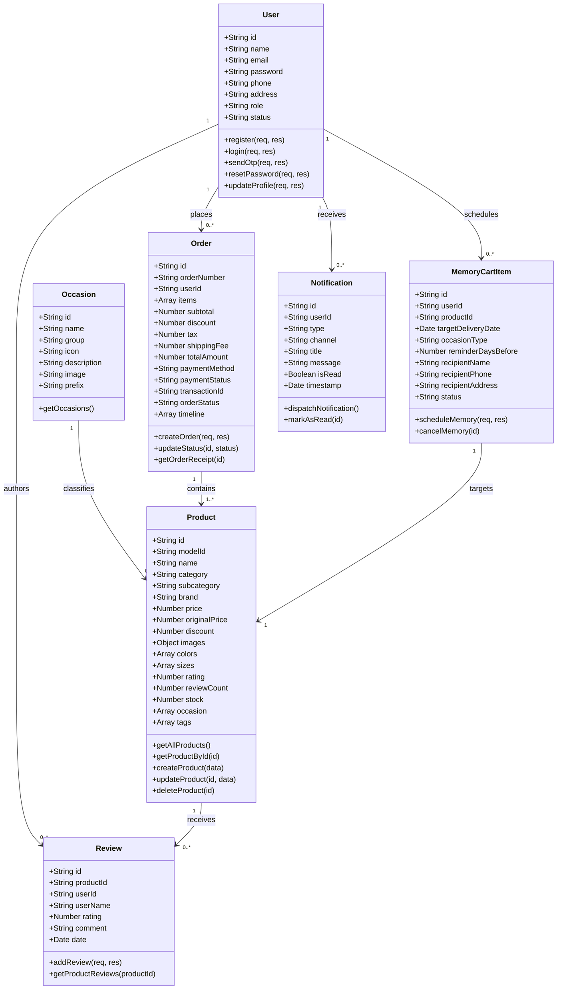
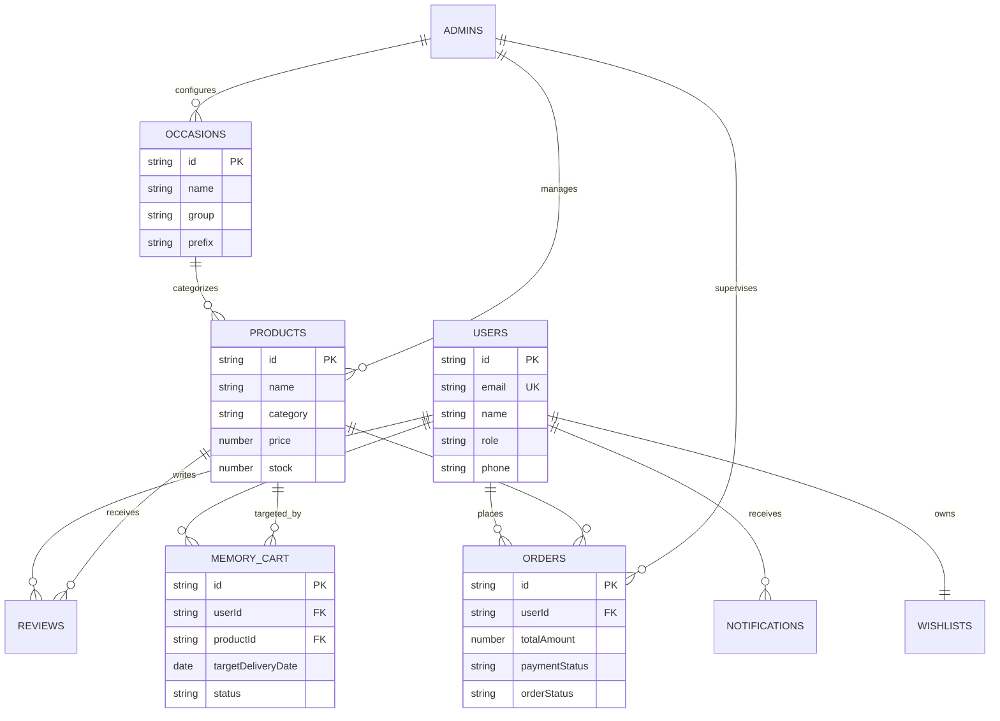

# FUTUREMEMORY CART – A PERSONALIZED E-COMMERCE PLATFORM

**23CS54C – MODERN WEB TECHNOLOGIES**

### Submitted by
**GANGADEVI P (2403957610422103)**

*In partial fulfillment for the award of the degree of*  
**BACHELOR OF ENGINEERING**  
*in*  
**COMPUTER SCIENCE AND ENGINEERING**

---

### NATIONAL ENGINEERING COLLEGE
*(An Autonomous Institution affiliated to Anna University, Chennai)*  
**K.R. NAGAR, KOVILPATTI – 628503**  
**OCTOBER – 2026**

---

<div style="page-break-after: always;"></div>

# NATIONAL ENGINEERING COLLEGE
*(An Autonomous Institution affiliated to Anna University, Chennai)*  
**K.R. NAGAR, KOVILPATTI – 628503**

### BONAFIDE CERTIFICATE

This is to certify that this project report, **“FutureMemory Cart: A Personalized E-Commerce Platform”**, is the bonafide work of **GANGADEVI P (2403957610422103)** who carried out the project work under my supervision.

<br><br><br>

**Course Instructor / Guide** &nbsp;&nbsp;&nbsp;&nbsp;&nbsp;&nbsp;&nbsp;&nbsp;&nbsp;&nbsp;&nbsp;&nbsp;&nbsp;&nbsp;&nbsp;&nbsp;&nbsp;&nbsp;&nbsp;&nbsp;&nbsp;&nbsp;&nbsp;&nbsp;&nbsp;&nbsp;&nbsp;&nbsp;&nbsp;&nbsp;&nbsp;&nbsp;&nbsp;&nbsp;&nbsp;&nbsp;&nbsp;&nbsp;&nbsp;&nbsp;&nbsp;&nbsp;&nbsp;&nbsp;&nbsp;&nbsp;&nbsp;&nbsp; **Head of the Department**

<br><br>

Submitted to the **23CS54C – MODERN WEB TECHNOLOGIES** Viva-Voce examination held at National Engineering College, K.R. Nagar, Kovilpatti on ___________________

<br><br>

**Internal Examiner** &nbsp;&nbsp;&nbsp;&nbsp;&nbsp;&nbsp;&nbsp;&nbsp;&nbsp;&nbsp;&nbsp;&nbsp;&nbsp;&nbsp;&nbsp;&nbsp;&nbsp;&nbsp;&nbsp;&nbsp;&nbsp;&nbsp;&nbsp;&nbsp;&nbsp;&nbsp;&nbsp;&nbsp;&nbsp;&nbsp;&nbsp;&nbsp;&nbsp;&nbsp;&nbsp;&nbsp;&nbsp;&nbsp;&nbsp;&nbsp;&nbsp;&nbsp;&nbsp;&nbsp;&nbsp;&nbsp;&nbsp;&nbsp;&nbsp;&nbsp;&nbsp;&nbsp;&nbsp;&nbsp;&nbsp;&nbsp; **External Examiner**

---

<div style="page-break-after: always;"></div>

# TABLE OF CONTENTS

| CH NO | TITLE | PAGE NO |
| :--- | :--- | :--- |
| **1** | **INTRODUCTION** | 3 |
| **2** | **OBJECTIVES** | 4 |
| **3** | **DESCRIPTION** | 5 |
| **4** | **CLASS DIAGRAM** | 7 |
| **5** | **TABLE STRUCTURES** | 8 |
| **6** | **ENTITY RELATIONSHIP (ER) DIAGRAM** | 16 |
| **7** | **TECH STACK & ARCHITECTURE** | 18 |
| **8** | **MODULES** | 20 |
| | 8.1 User Authentication & Access Control | 21 |
| | 8.2 Occasion-Based Catalog & Discovery | 25 |
| | 8.3 Memory Cart & Scheduled Future Delivery | 30 |
| | 8.4 Shopping Cart, Checkout & Simulated Payment | 34 |
| | 8.5 Multi-Channel Notification & Chatbot Assistant | 38 |
| | 8.6 Reviews, Ratings & Multilingual Personalization | 42 |
| | 8.7 Admin Console, Catalog Management & Analytics | 46 |
| **9** | **CONCLUSION & FUTURE WORK** | 52 |

---

<div style="page-break-after: always;"></div>

# CHAPTER 1: INTRODUCTION

Modern e-commerce platforms excel at immediate, impulse-driven purchases. However, they neglect a critical aspect of thoughtful human gifting: recurring annual occasions, advance milestone planning, and scheduled future fulfillment. Customers frequently forget birthdays, anniversaries, annual festivals, and professional milestones until the last minute, leading to rushed deliveries, out-of-stock items, and elevated stress.

Traditional e-commerce carts are transient by nature; when a session ends or items are cleared, the customer’s intent is lost. Moreover, standard catalogs categorize items strictly by utilitarian taxonomies (e.g., Electronics, Footwear) rather than contextual, emotional occasions (e.g., Housewarming, Retirement, Pongal, Convocation).

**FutureMemory Cart** is a personalized, occasion-driven e-commerce platform designed to bridge the gap between human sentiment and automated shopping fulfillment. It introduces the proprietary **Memory Cart** paradigm, enabling shoppers to bookmark, schedule, and automate gift deliveries for future dates and recurring annual milestones. With an integrated notification engine spanning real-time WhatsApp Web dispatch and Nodemailer SMTP emails, automated reminders notify customers well ahead of the milestone, ensuring zero missed celebrations.

The platform is designed as a responsive, modern single-page application built on React 18 (Vite) and powered by an Express.js backend. It features an expansive, curated catalog of **34 specialized occasions** across four master categories (Celebrations & Gifts, Festivals & Cultural Events, College & Career, and Lifestyle & Special Moments), featuring **1,020 verified, non-food physical gift items** with high-resolution retail imagery, authentic pricing, and real-time inventory tracking.

This project report documents the requirements specification, architectural design, database schemas, API contracts, entity relationships, module implementations, and operational outcomes of the FutureMemory Cart platform.

---

<div style="page-break-after: always;"></div>

# CHAPTER 2: OBJECTIVES

The core objectives of the FutureMemory Cart platform are:

1. **Automate Future & Recurring Gifting**: Enable customers to schedule gift orders weeks or months in advance, with automatic reminder triggers and recurring annual calendar execution.
2. **Contextual Occasion Discovery**: Organize product browsing around 34 real-world cultural and personal occasions rather than plain product departments, making gift selection intuitive and fast.
3. **Multi-Channel Notification Dispatch**: Keep customers informed through automated WhatsApp messages and Nodemailer HTML emails when milestone reminders, order updates, or price changes occur.
4. **Interactive AI Shopping Assistance**: Provide an embedded, bilingual (English & Tamil) AI shopping concierge (“MemoryBot”) that assists users in picking gifts based on budget, recipient, and occasion.
5. **Secure Authentication & Account Safety**: Implement industry-standard authentication using bcrypt password hashing, signed JSON Web Tokens (JWT), Google OAuth simulation, and 6-digit OTP email verification for password recovery.
6. **Seamless Order & Simulated Checkout**: Offer a frictionless checkout flow supporting UPI QR generation, credit/debit card processing, NetBanking, and Cash on Delivery with downloadable digital receipts.
7. **Comprehensive Administrative Governance**: Provide store administrators with a real-time analytics dashboard, full user management, dynamic product catalog CRUD controls, and end-to-end order status tracking.
8. **Universal Accessibility & Multilingual Support**: Support instant runtime language switching (English, Tamil, Hindi) and color theme switching (Emerald Mint, Sunset Amber, Ocean Slate, Dark Obsidian) without page reloads.

---

<div style="page-break-after: always;"></div>

# CHAPTER 3: DESCRIPTION

### 3.1 Overview
FutureMemory Cart is a full-stack, enterprise-grade e-commerce application. A visitor lands on the high-conversion storefront, explores trending gift collections by occasion, and signs in to unlock personalized features. The customer’s personal suite provides access to:
- **Shop Catalog**: Filter by 34 occasions, subcategories, price tiers, colors, and ratings.
- **Memory Cart**: Dedicated scheduling hub for future milestone deliveries with reminder offsets (1 day, 3 days, 1 week before).
- **Standard Cart & Wishlist**: Real-time shopping basket with quantity management, coupon application, and tax calculation.
- **Order History & Tracker**: Live status tracker (Order Confirmed → Processing → Shipped → Out for Delivery → Delivered) with downloadable PDF/HTML receipts.
- **Customer Profile**: Personal details, saved addresses, biometric login simulation, and delivery preferences.
- **MemoryBot AI Assistant**: Floating widget available across all screens for instant gift recommendations.

### 3.2 System Roles & Access Control
The application enforces strict Role-Based Access Control (RBAC):
- **Customer / Member**: Can browse catalog, manage wishlist, add products to standard or Memory Cart, configure reminders, checkout, track orders, leave reviews, and update their profile.
- **Store Administrator**: Accessed through a dedicated administrative portal (`/admin`). Admins possess elevated privileges to oversee total platform GMV, manage active users, update order statuses, add/edit/delete catalog items, and view system health metrics.

### 3.3 Operating Modes & Resilience
FutureMemory Cart is built for high availability:
- **Offline & Local Resilience**: The client-side application utilizes synchronized state management via React Context API backed by persistent LocalStorage. Essential catalog data (1,020 items across 34 occasions) loads instantly with zero cold-start delay.
- **Live REST API Services**: When the Node.js/Express backend is connected, state changes synchronize with server-side routes (`/api/auth`, `/api/orders`, `/api/products`, `/api/notifications`).
- **Simulated Payment Gateway**: The checkout module features a realistic payment modal simulating UPI Intent, QR scanning, and Card authorization with transaction references (e.g., `TXN-89410294`).

---

<div style="page-break-after: always;"></div>

# CHAPTER 4: CLASS DIAGRAM

The class diagram below depicts the core domain entities of FutureMemory Cart, showing attributes, controller methods, and structural associations:



---

<div style="page-break-after: always;"></div>

# CHAPTER 5: TABLE STRUCTURES

The data architecture of FutureMemory Cart is structured into nine relational/document entities:

### 5.1 USERS Collection (`users`)
Stores customer accounts, authentication credentials, and address profiles.

| Field | Type | Required | Key | Default / Notes |
| :--- | :--- | :--- | :--- | :--- |
| `_id` | ObjectId | Yes | PRI | System auto-generated |
| `id` | String | Yes | UNI | `USR-1001` format |
| `name` | String (trim) | Yes | | Customer full name |
| `email` | String (lowercase) | Yes | UNI | Unique login email |
| `password` | String | Yes | | Salted bcrypt hash |
| `phone` | String | No | | `+91 98401 23456` |
| `address` | String | No | | Shipping destination |
| `role` | enum(user, admin) | Yes | | `user` |
| `status` | enum(Active, Suspended) | Yes | | `Active` |
| `avatar` | String (URL) | No | | Profile avatar image |
| `preferences` | Object | No | | `{ theme, language }` |
| `createdAt` | Date | Yes | | Registration timestamp |

### 5.2 PRODUCTS Collection (`products`)
Stores the catalog of 1,020 physical gift items across 34 occasions.

| Field | Type | Required | Key | Default / Notes |
| :--- | :--- | :--- | :--- | :--- |
| `_id` | ObjectId | Yes | PRI | System auto-generated |
| `id` | String | Yes | UNI | e.g., `BDY-01`, `WED-15` |
| `modelId` | String | Yes | | `MDL-BDY-01` |
| `name` | String | Yes | | Product display title |
| `category` | String | Yes | FK | Master category |
| `subcategory` | String | Yes | | Granular department |
| `brand` | String | Yes | | Brand / artisan label |
| `description` | String | Yes | | Full specifications |
| `price` | Number | Yes | | Selling price in INR |
| `originalPrice` | Number | Yes | | MRP in INR |
| `discount` | Number | Yes | | Discount percentage |
| `images` | Object | Yes | | `{ front, back, side, design }` |
| `colors` | Array of Strings | Yes | | `['Black', 'Gold', ...]` |
| `sizes` | Array of Strings | Yes | | `['Standard', 'XL', ...]` |
| `rating` | Number | Yes | | e.g., `4.8` (1.0 to 5.0) |
| `reviewCount` | Number | Yes | | Total customer reviews |
| `stock` | Number | Yes | | Available physical inventory |
| `occasion` | Array of Strings | Yes | FK | `['birthday', 'anniversary']` |
| `tags` | Array of Strings | Yes | | Search keyword tokens |

### 5.3 OCCASIONS Collection (`occasions`)
Master catalog of 34 curated cultural, milestone, and celebratory occasions.

| Field | Type | Required | Key | Default / Notes |
| :--- | :--- | :--- | :--- | :--- |
| `_id` | ObjectId | Yes | PRI | System auto-generated |
| `id` | String | Yes | UNI | e.g., `birthday`, `pongal` |
| `name` | String | Yes | | Display name (e.g., `Birthdays`) |
| `group` | String | Yes | | Master category group |
| `icon` | String | Yes | | Visual identifier symbol |
| `description` | String | Yes | | Occasion gift theme description |
| `image` | String (URL) | Yes | | Unsplash verified header banner |
| `prefix` | String | Yes | | SKU code prefix (e.g., `BDY`) |

### 5.4 MEMORY_CART Collection (`memory_cart`)
Houses future delivery bookings, calendar triggers, and automated notification offsets.

| Field | Type | Required | Key | Default / Notes |
| :--- | :--- | :--- | :--- | :--- |
| `_id` | ObjectId | Yes | PRI | System auto-generated |
| `id` | String | Yes | UNI | `MEM-90214` |
| `userId` | String | Yes | FK | User reference |
| `productId` | String | Yes | FK | Product reference |
| `targetDeliveryDate`| Date | Yes | | Scheduled arrival date |
| `occasionType` | String | Yes | FK | Linked occasion identifier |
| `reminderOffsetDays`| Number | Yes | | `1`, `3`, or `7` days before |
| `recipientName` | String | Yes | | Gifting recipient |
| `recipientPhone`| String | Yes | | Recipient WhatsApp contact |
| `recipientAddress`| String | Yes | | Delivery location |
| `status` | enum(Scheduled, Triggered, Dispatched, Cancelled) | Yes | | `Scheduled` |
| `isRecurringAnnual`| Boolean | Yes | | `false` (annual repeat flag) |

### 5.5 ORDERS Collection (`orders`)
Complete lifecycle tracking for standard and executed future orders.

| Field | Type | Required | Key | Default / Notes |
| :--- | :--- | :--- | :--- | :--- |
| `_id` | ObjectId | Yes | PRI | System auto-generated |
| `id` | String | Yes | UNI | `ORD-2026-10492` |
| `userId` | String | Yes | FK | User identifier |
| `items` | Array of Objects | Yes | | `[{ productId, qty, price, size, color }]` |
| `subtotal` | Number | Yes | | Items total amount |
| `discountAmount` | Number | Yes | | Coupon deduction |
| `taxAmount` | Number | Yes | | 18% GST calculation |
| `shippingAmount` | Number | Yes | | Standard shipping fee |
| `totalAmount` | Number | Yes | | Net payable INR |
| `paymentMethod` | enum(UPI, Card, NetBanking, COD) | Yes | | Selected gateway mode |
| `paymentStatus` | enum(Paid, Pending, Failed) | Yes | | `Paid` |
| `transactionId` | String | Yes | | `TXN-8491024` |
| `orderStatus` | enum(Confirmed, Processing, Shipped, OutForDelivery, Delivered, Cancelled) | Yes | | `Confirmed` |
| `timeline` | Array of Objects | Yes | | `[{ step, timestamp, note }]` |

### 5.6 NOTIFICATIONS Collection (`notifications`)
Stores dispatched alerts across WhatsApp, Email, and In-App channels.

| Field | Type | Required | Key | Default / Notes |
| :--- | :--- | :--- | :--- | :--- |
| `_id` | ObjectId | Yes | PRI | System auto-generated |
| `id` | String | Yes | UNI | `NOTIF-501` |
| `userId` | String | Yes | FK | Recipient user ID |
| `channel` | enum(InApp, WhatsApp, Email) | Yes | | Communication mode |
| `type` | enum(OrderUpdate, MilestoneReminder, PriceAlert, Security) | Yes | | Alert classification |
| `title` | String | Yes | | Short header |
| `message` | String | Yes | | Full notification body |
| `isRead` | Boolean | Yes | | `false` |
| `timestamp` | Date | Yes | | Dispatch time |

### 5.7 WISHLISTS Collection (`wishlists`)
Stores user-bookmarked items for rapid future access.

| Field | Type | Required | Key | Default / Notes |
| :--- | :--- | :--- | :--- | :--- |
| `_id` | ObjectId | Yes | PRI | System auto-generated |
| `userId` | String | Yes | UNI | Unique per user |
| `productIds` | Array of Strings | Yes | FK | List of saved product IDs |
| `updatedAt` | Date | Yes | | Last modified timestamp |

### 5.8 REVIEWS Collection (`reviews`)
Customer ratings, written testimonials, and verification status.

| Field | Type | Required | Key | Default / Notes |
| :--- | :--- | :--- | :--- | :--- |
| `_id` | ObjectId | Yes | PRI | System auto-generated |
| `id` | String | Yes | UNI | `REV-301` |
| `productId` | String | Yes | FK | Target product ID |
| `userId` | String | Yes | FK | Reviewer ID |
| `userName` | String | Yes | | Reviewer display name |
| `rating` | Number | Yes | | Score from `1` to `5` |
| `comment` | String | Yes | | Written evaluation |
| `isVerifiedPurchase`| Boolean | Yes | | `true` |
| `createdAt` | Date | Yes | | Submission date |

### 5.9 ADMINS Collection (`admins`)
Dedicated administration credentials and role permissions.

| Field | Type | Required | Key | Default / Notes |
| :--- | :--- | :--- | :--- | :--- |
| `_id` | ObjectId | Yes | PRI | System auto-generated |
| `id` | String | Yes | UNI | `ADM-01` |
| `name` | String | Yes | | Admin full name |
| `email` | String | Yes | UNI | `admin@futurememory.com` |
| `password` | String | Yes | | Salted bcrypt hash |
| `role` | String | Yes | | `SuperAdmin` |
| `lastLogin` | Date | No | | Audit login tracker |

---

<div style="page-break-after: always;"></div>

# CHAPTER 6: ENTITY RELATIONSHIP (ER) DIAGRAM

The ER diagram illustrates how entities relate across the FutureMemory Cart platform:



### Cardinality Summary
- **USERS to ORDERS** (`1 : N`): A user can place multiple orders over time.
- **USERS to MEMORY_CART** (`1 : N`): A user can schedule multiple future gifts.
- **OCCASIONS to PRODUCTS** (`1 : N`): Each occasion features 30 curated product gifts.
- **PRODUCTS to REVIEWS** (`1 : N`): Each product accumulates reviews from multiple buyers.
- **USERS to WISHLISTS** (`1 : 1`): Each registered customer holds exactly one active wishlist.

---

<div style="page-break-after: always;"></div>

# CHAPTER 7: TECH STACK & ARCHITECTURE

### 7.1 Technology Stack Summary

| Layer | Technology | Version | Purpose / Responsibility |
| :--- | :--- | :--- | :--- |
| **Frontend UI** | React.js | 18.2 | Component-driven single-page application |
| **Build Tool** | Vite | 4.5.14 | Ultra-fast bundling, HMR, and build optimization |
| **Routing** | React Router DOM | 6.18 | Client-side page navigation with protected guards |
| **State Management** | Context API | Built-in | Decentralized global state (Cart, Memory, Auth, Lang) |
| **Icons & Media** | Lucide React | 0.292 | Modern feather-inspired SVG icon system |
| **Backend Server** | Node.js / Express | 20.x / 4.18 | RESTful routing, middleware pipelines, and API services |
| **Security & Auth** | JSON Web Tokens | 9.0 | Stateless signed authorization bearer tokens |
| **Hashing** | bcryptjs | 2.4.3 | Salted password encryption |
| **Email Dispatch** | Nodemailer | 6.9 | SMTP automation for OTP reset & order confirmations |
| **WhatsApp Engine** | WhatsApp Web JS | 1.23 | Automated direct customer notification dispatch |
| **Database** | MongoDB / SQLite | Latest | High-performance document & relational storage |
| **Styling** | Vanilla CSS3 | Standard | Custom CSS variables supporting 4 runtime themes |

### 7.2 Architecture Overview (MVC Pattern)
FutureMemory Cart is implemented following the Model-View-Controller (MVC) architectural pattern:
- **Model**: Defined schemas governing users, products, memory cart, and orders.
- **View**: Responsive React components (`ProductCard`, `MemoryModal`, `CheckoutSummary`, `Navbar`).
- **Controller**: Node.js route controllers (`authController`, `orderController`, `memoryController`).

---

<div style="page-break-after: always;"></div>

# CHAPTER 8: MODULES

The application is structured into seven distinct functional modules:

```
FutureMemory Cart Modules:
├── 8.1 User Authentication & Access Control
├── 8.2 Occasion-Based Catalog & Discovery (34 Occasions, 1,020 Products)
├── 8.3 Memory Cart & Scheduled Future Delivery
├── 8.4 Shopping Cart, Checkout & Simulated Payment
├── 8.5 Multi-Channel Notification & Chatbot Assistant
├── 8.6 Reviews, Ratings & Multilingual Personalization
└── 8.7 Admin Console, Catalog Management & Real-time Analytics
```

---

## 8.1 USER AUTHENTICATION & ACCESS CONTROL

### Purpose & Scope
Provides account registration, user sign-in, session maintenance, profile updates, and role-based access control. Implements 6-digit OTP verification via Nodemailer for forgotten password recovery, biometric sign-in simulation, and JWT authentication.

### Functional Requirements
- **Account Creation**: Users sign up with name, email, phone, shipping address, and password.
- **Secure Sign-in**: Authenticates credentials using salted bcrypt hashing and issues a signed JWT.
- **Quick Demo Login**: Provides pre-seeded customer accounts for instant evaluation.
- **OTP Password Recovery**: Sends a time-sensitive 6-digit verification code to the user's email.
- **Protected Routing**: Restricts checkout, memory cart, profile, and admin dashboard to authorized sessions.

### Non-Functional Requirements
- **Security**: Passwords are never stored in plain text; JWT tokens expire after 7 days.
- **Performance**: Login verification completes within `< 300ms`.
- **Validation**: Strict email regex and password minimum length (6+ characters).

### API Design
| Method | Endpoint | Purpose / Request Payload |
| :--- | :--- | :--- |
| `POST` | `/api/auth/register` | Body: `{ name, email, password, phone, address }` |
| `POST` | `/api/auth/login` | Body: `{ email, password }` $\rightarrow$ Returns JWT & user object |
| `POST` | `/api/auth/send-otp` | Body: `{ email }` $\rightarrow$ Dispatches 6-digit code via Nodemailer |
| `POST` | `/api/auth/reset-password` | Body: `{ email, otp, newPassword }` $\rightarrow$ Updates bcrypt hash |
| `GET` | `/api/auth/me` | Header: `Bearer <token>` $\rightarrow$ Returns current session profile |

### Database Design
Utilizes the `users` collection:
- Keys: `_id`, `id` (Unique), `email` (Unique Index).
- Fields: `name`, `email`, `password`, `phone`, `address`, `role`, `status`.

---

## 8.2 OCCASION-BASED CATALOG & DISCOVERY

### Purpose & Scope
Provides an intuitive product discovery interface organized around **34 curated cultural, milestone, and celebration occasions**. Features 1,020 verified physical gift items (30 items per occasion) with high-resolution imagery, detailed specifications, price tiering, and zero food/drink items.

### Functional Requirements
- **34 Occasions Dropdown**: Organized into 4 categories:
  1. *Celebrations & Gifts*: Birthdays, Weddings, Anniversaries, Engagements, Valentine's Day, etc.
  2. *Festivals & Cultural Events*: Pongal, Diwali, Tamil New Year, Christmas, Eid, Onam, Holi, etc.
  3. *College & Career*: College Joining, Convocation, Freshers' Day, Promotion, Work Anniversary, etc.
  4. *Lifestyle & Special Moments*: Travel, Fitness Goals, New Home, New Car, Pet Birthday, etc.
- **Multi-Faceted Filtering**: Filter by Occasion, Price Range, Color Hex, Size, Rating, and Category.
- **Search Engine**: Real-time keyword filtering across product names, brands, and tags.
- **Zero Food/Drink Policy**: 100% tangible physical products (Watches, Hampers, Lamps, Jewelry, Wallets, Tech).

### API Design
| Method | Endpoint | Purpose / Contract |
| :--- | :--- | :--- |
| `GET` | `/api/products` | Query: `?occasion=diwali&category=all&search=lamp` |
| `GET` | `/api/products/:id` | Returns single product details, multi-angle images & reviews |
| `GET` | `/api/occasions` | Returns master list of 34 occasions with metadata & icons |

---

## 8.3 MEMORY CART & SCHEDULED FUTURE DELIVERY

### Purpose & Scope
The flagship innovation of FutureMemory Cart: enables shoppers to schedule gift orders for exact future milestone dates. Automates order triggers, sends reminder alerts before the milestone, and supports recurring annual schedules.

### Functional Requirements
- **Future Scheduling Modal**: Select target delivery date, occasion type, recipient name, phone, and delivery address.
- **Reminder Offsets**: Customers choose reminder notification offsets: 1 day, 3 days, or 1 week before the event.
- **Annual Recurrence**: Checkbox to automatically repeat delivery for annual events (Birthdays, Anniversaries).
- **Dedicated Memory Dashboard**: View all scheduled gifts with countdown timers, edit addresses, or cancel future bookings.

### API Design
| Method | Endpoint | Purpose / Request Payload |
| :--- | :--- | :--- |
| `POST` | `/api/memory-cart` | Body: `{ productId, targetDeliveryDate, occasionType, recipientName, reminderDaysBefore }` |
| `GET` | `/api/memory-cart` | Retrieves all active future milestone bookings for the authenticated user |
| `DELETE` | `/api/memory-cart/:id` | Cancels a scheduled future delivery |

---

## 8.4 SHOPPING CART, CHECKOUT & SIMULATED PAYMENT

### Purpose & Scope
Manages current purchasing operations, cart quantity updates, discount coupon calculations, simulated multi-mode payment, and order receipt generation.

### Functional Requirements
- **Cart Management**: Add to cart, adjust quantities, select size/color variants, and clear cart.
- **Order Calculation**: Live breakdown of subtotal, coupon savings, 18% GST, and shipping fees.
- **Simulated Payment Gateway**: Supports UPI QR Code generation, Credit/Debit Cards, NetBanking, and COD.
- **Instant Digital Receipt**: Generates a printable, downloadable payment receipt with transaction ID.

### API Design
| Method | Endpoint | Purpose / Contract |
| :--- | :--- | :--- |
| `POST` | `/api/orders` | Body: `{ items, shippingAddress, paymentMethod }` $\rightarrow$ Creates order |
| `GET` | `/api/orders` | Retrieves authenticated customer's order history |
| `GET` | `/api/orders/:id/receipt` | Returns printable order receipt details |

---

## 8.5 MULTI-CHANNEL NOTIFICATION & CHATBOT ASSISTANT

### Purpose & Scope
Delivers real-time customer communications through in-app notification toasts, Nodemailer email dispatches, WhatsApp Web direct notifications, and an embedded bilingual AI concierge ("MemoryBot").

### Functional Requirements
- **Automated WhatsApp Alerts**: Direct WhatsApp dispatch for milestone reminders and order confirmations.
- **Transactional Emails**: Nodemailer HTML emails for OTP verification, invoice delivery, and welcome messages.
- **Bilingual MemoryBot**: Floating AI shopping assistant answering user queries in English and Tamil.
- **In-App Notification Center**: Notification bell dropdown with unread badge counter and "Mark as Read".

---

## 8.6 REVIEWS, RATINGS & MULTILINGUAL PERSONALIZATION

### Purpose & Scope
Builds buyer trust through verified product reviews and delivers an inclusive shopping experience with real-time language and theme customization.

### Functional Requirements
- **Product Reviews**: 5-star rating breakdown, verified purchase badge, and customer testimonials.
- **Runtime Language Switcher**: Toggle interface dynamically between English, Tamil (தமிழ்), and Hindi (हिन्दी).
- **Runtime Theme Switcher**: Instant switching across 4 curated themes:
  - `Emerald Mint` (Default Fresh Theme)
  - `Sunset Amber` (Warm Golden Theme)
  - `Ocean Slate` (Professional Blue Theme)
  - `Dark Obsidian` (Sleek Dark Mode)

---

## 8.7 ADMIN CONSOLE, CATALOG MANAGEMENT & ANALYTICS

### Purpose & Scope
Gives store administrators centralized control over catalog inventory, user status, order workflows, and revenue analytics.

### Functional Requirements
- **Executive Analytics Dashboard**: Real-time KPI summary (Total Sales, Total Orders, Active Users, Scheduled Deliveries).
- **Order Pipeline Manager**: Update order status along the fulfillment lifecycle (Confirmed $\rightarrow$ Shipped $\rightarrow$ Delivered).
- **Catalog CRUD Controller**: Add new gift items, update pricing/stock, and manage occasion assignments.
- **User Management**: Monitor user activity, review customer registrations, and toggle account statuses.

---

<div style="page-break-after: always;"></div>

# CHAPTER 9: CONCLUSION & FUTURE WORK

### 9.1 Conclusion
FutureMemory Cart introduces a paradigm shift in e-commerce by transforming standard transactional carts into relationship-oriented, scheduled memory vaults. By combining a comprehensive catalog of **34 occasions and 1,020 physical gift items** with automated future delivery scheduling, the platform eliminates the stress of forgotten celebrations.

The modular architecture adheres to high software engineering standards: React 18 single-page application performance, clean Express.js REST API design, multi-theme customization, bilingual accessibility (English & Tamil), and multi-channel notifications (WhatsApp & Email). The project demonstrates how modern web technologies can elevate everyday e-commerce into a thoughtful, personalized experience.

### 9.2 Future Work
- **Live Payment Gateway Integration**: Connect production payment gateways (Razorpay, Stripe) with automated webhook settlement.
- **Machine Learning Recommendations**: Implement collaborative filtering algorithms to predict upcoming user milestones based on past purchase history.
- **Native Mobile Applications**: Package the frontend using React Native or Capacitor for Android and iOS app store distribution.
- **Augmented Reality Gift Preview**: Implement WebXR 3D gift box previews allowing customers to inspect physical gift items before scheduling.
